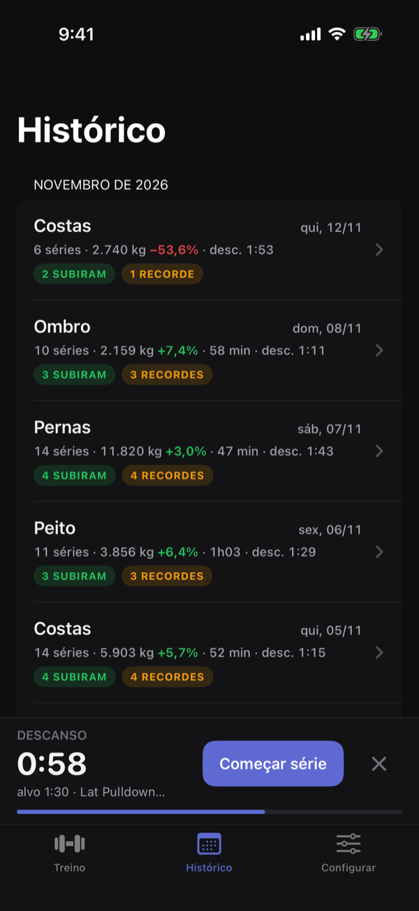
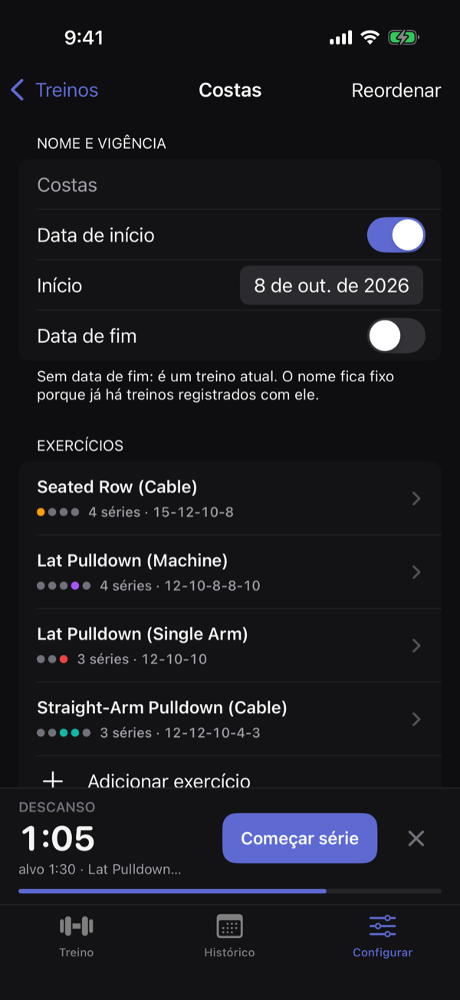
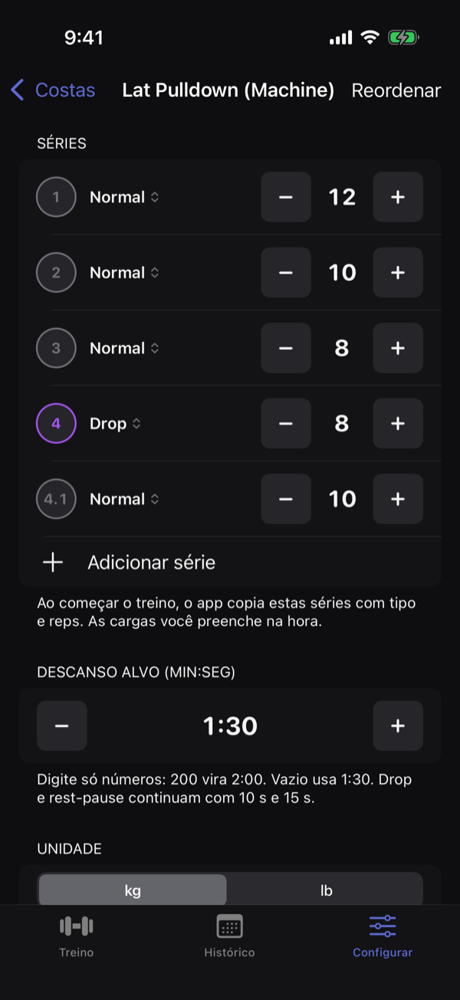

# Gimmy

> **Projeto pessoal.** Fiz o Gimmy para o meu uso, em cima da minha planilha de treinos. Não é um produto: não tem suporte, não aceita pedidos de funcionalidade e pode mudar a qualquer momento. O código fica aqui como referência para quem quiser montar algo parecido.

App de iPhone para registrar treinos. É a versão nativa (SwiftUI) do artefato **Registro de Treino**: mesmas telas, mesmas regras, e a planilha **Controle de Treinos** no Google Drive continua sendo a base de dados. O app lê e grava direto nela pela API do Google Sheets.

- iOS 17 ou mais novo, só iPhone.
- Sem servidor e sem conta de desenvolvedor paga: você instala com seu Apple ID gratuito e reinstala a cada 7 dias.

## O que tem no app

- **Treino**: escolhe o treino (o seletor só mostra os vigentes na data) e a data. Num dia sem treino, Começar treino cria uma cópia do treino configurado, com exercícios, tipos de série e reps, e só as cargas em branco. Registra cada série (carga, reps, tipo, unidade, descanso), adiciona série e exercício, e finaliza com a duração.
- **Descanso**: depois de registrar uma série, o relógio de descanso aparece em baixo. Quando chega no alvo do exercício (padrão 1:30), o iPhone avisa com notificação e som, mesmo bloqueado.
- **Histórico**: treinos por mês, com volume e variação contra o treino anterior, exercícios que subiram ou caíram e recordes. Dá para abrir um treino antigo para editar.
- **Configurar**: cria e edita os treinos. Cada treino tem nome e vigência (início e fim; o atual fica sem fim), uma lista de exercícios em ordem e, em cada exercício, as séries (tipo e reps), o descanso alvo, a unidade e as notas. Um nome pode voltar com outra vigência (um plano novo de Costas, por exemplo) sem misturar com o antigo.

As regras de cálculo são as mesmas do artefato: numeração de séries com drop e rest-pause (3.1, 3.2), descanso curto dentro da sequência (10 s depois de drop, 15 s depois de rest-pause), 1RM estimado (Brzycki até 10 reps, Epley acima), volume em kg sem aquecimento, recorde só quando o exercício também subiu.

## Telas

<table>
  <tr>
    <td align="center" width="33%"><br><sub>Treino do dia</sub></td>
    <td align="center" width="33%"><br><sub>Registrar uma série</sub></td>
    <td align="center" width="33%"><br><sub>Histórico</sub></td>
  </tr>
  <tr>
    <td align="center"><br><sub>Treinos e vigência</sub></td>
    <td align="center"><br><sub>Configurar um treino</sub></td>
    <td align="center"><br><sub>Séries de um exercício</sub></td>
  </tr>
</table>

Os prints usam dados de exemplo, não a planilha de verdade. Para gerar de novo: **Actions › Screenshots › Run workflow**. O workflow abre o app num simulador de iPhone com o argumento `-demo` (só existe em build de debug), passa pelas telas e grava as imagens em `docs/screenshots`.

## Como a planilha é usada

O app usa as abas que já existem. Na aba Rotinas ele acrescenta três colunas no fim (J, K e L), sem mexer nas outras.

| Aba | O app lê | O app grava |
|---|---|---|
| Registro | A–Q | A–F ao montar treino ou adicionar séries/exercícios (insere linhas), D–F ao salvar série, P (descanso), Q (duração) |
| Rotinas | A–L | pela aba Configurar: A–C, F–L (D e E têm fórmulas e nunca são gravadas); insere e apaga linhas |
| Exercícios | A–D | D (unidade kg/lb), ou uma linha nova para exercício novo |

Na aba Rotinas, cada linha é um exercício de um treino:

- **G (Reps)** tem uma rep por série, na ordem: `12-10-8-6-8`.
- **J (Tipos)** tem o tipo de cada série, na mesma ordem: `Aquecimento, Normal, Normal, Drop, Normal`. Linhas sem J (as antigas) continuam valendo: o app copia as séries do último treino daquele exercício, ou usa F e G.
- **K (Início)** e **L (Fim)** são a vigência do treino, repetidas em todas as linhas dele. L vazio é o treino atual; K e L vazios valem sempre. Linhas com o mesmo nome e o mesmo início formam um treino.
- Um treino sem exercícios fica guardado numa linha só com nome e datas.

Antes de gravar numa linha, o app confere se ela ainda tem o que ele espera. Se a planilha mudou (por exemplo, você editou no computador), ele recarrega e pede para conferir.

## Configuração (uma vez)

### 1. Google Cloud: credencial para o app

1. Abra [console.cloud.google.com](https://console.cloud.google.com) e crie um projeto (por exemplo, "Gimmy").
2. Em **APIs e serviços → Biblioteca**, ative a **Google Sheets API**.
3. Em **Google Auth Platform** (tela de consentimento OAuth):
   - Público: **Externo**.
   - Adicione o seu e-mail em **Usuários de teste**.
4. Em **Clientes → Criar cliente**, escolha o tipo **iOS** e informe o **Bundle ID** que você vai usar (por exemplo `com.seunome.gimmy`).
5. Copie o **ID do cliente** (`1234-abcd.apps.googleusercontent.com`).

> **Sobre o login a cada 7 dias**: enquanto o app do Google Cloud estiver em modo "Teste", o Google expira o login depois de 7 dias. Como você já reinstala o Gimmy toda semana, é só entrar de novo na mesma hora. Se quiser evitar isso, publique o app (Público → **Publicar app**). Ele continua só para você, mas o Google mostra um aviso de "app não verificado" no login, que você aceita uma vez.

### 2. Seus IDs no projeto

```bash
cp Config/Secrets.example.xcconfig Config/Secrets.xcconfig
```

Preencha `Config/Secrets.xcconfig`:

- `APP_BUNDLE_ID`: o mesmo Bundle ID do passo 1.4.
- `GOOGLE_CLIENT_ID_PREFIX`: o ID do cliente **sem** `.apps.googleusercontent.com`.
- `SPREADSHEET_ID`: o trecho da URL da planilha entre `/d/` e `/edit`.
- `DEVELOPMENT_TEAM`: só se for compilar no Xcode (o ID do seu time em Xcode → Settings → Accounts).

Esse arquivo não vai para o git.

## Instalar no iPhone

Escolha um dos caminhos. Nos dois, o certificado do Apple ID gratuito vale 7 dias; depois disso o app para de abrir e você instala de novo (seus dados ficam na planilha, nada se perde).

No iPhone, ative o **Modo de Desenvolvedor** uma vez: Ajustes → Privacidade e Segurança → Modo de Desenvolvedor.

### Caminho A: Mac com Xcode

```bash
brew install xcodegen
```

```bash
xcodegen generate
```

```bash
open Gimmy.xcodeproj
```

No Xcode: selecione o alvo **Gimmy** → Signing & Capabilities → Team = seu Apple ID. Conecte o iPhone, escolha-o como destino e aperte ▶︎. Para reinstalar na semana seguinte, é só apertar ▶︎ de novo.

### Caminho B: sem Mac (Windows ou Mac), com o IPA do GitHub

1. No GitHub, em **Settings → Secrets and variables → Actions**, crie os secrets `APP_BUNDLE_ID`, `GOOGLE_CLIENT_ID_PREFIX` e `SPREADSHEET_ID` com os valores do passo 2.
2. Em **Actions → Build IPA → Run workflow** (ou a cada push na `main`), o GitHub compila e publica o `Gimmy.ipa` como artefato da execução.
3. Baixe o IPA e instale com o [Sideloadly](https://sideloadly.io) (ou AltStore) usando seu Apple ID. Repita a cada 7 dias.

No Sideloadly, deixe o Bundle ID como está (o mesmo registrado no cliente iOS do Google).

## Estrutura

```
Gimmy/
  App/        entrada do app e configuração
  Google/     login OAuth (PKCE, Keychain) e cliente da API do Sheets
  Model/      regras de treino (Ledger), treinos configurados e vigência (Plan), estado e ações (AppModel), aviso de descanso
  Views/      telas SwiftUI
  Resources/  Info.plist, ícone e cor de destaque
GimmyTests/   testes unitários das regras de treino (rodam no GitHub antes de gerar o IPA)
GimmyUITests/ teste de interface que tira os prints do README (workflow Screenshots)
docs/         prints do README
project.yml   projeto do XcodeGen (o .xcodeproj é gerado, não versionado)
```

## Interface

O visual segue o design system **Kinetic Dark Minimal**, descrito em [`DESIGN.md`](DESIGN.md) e implementado em `Gimmy/App/Theme.swift`: modo escuro, superfícies em camadas, índigo `#5E6AD2` como cor de ação e uma cor por tipo de série. A tela de treino mostra um exercício por vez, e tocar numa série abre o painel com a Entrada Rápida de carga e reps.
