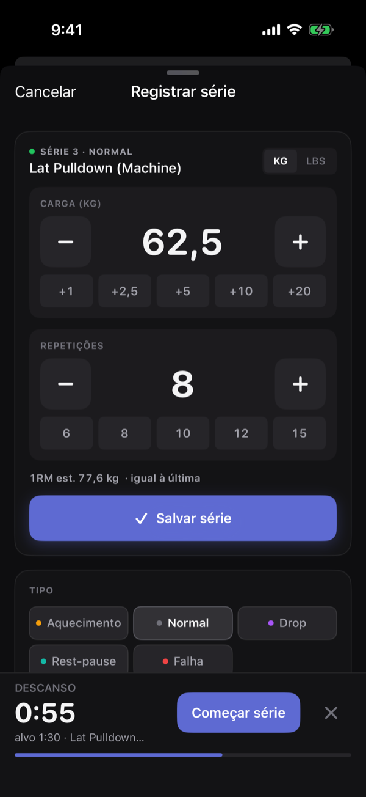
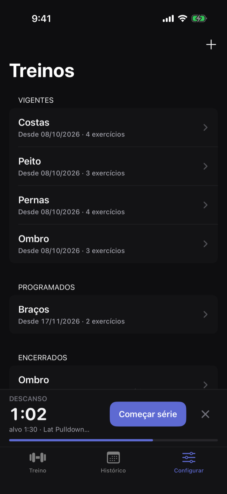

# Gimmy

> **Personal app.** Gimmy is the app I use to track my own workouts, and nothing else. It exists for my use only, reading from and writing to my own spreadsheet. It is not distributed, has no install instructions, does not accept contributions or feature requests, and may change at any time.

An iPhone app (SwiftUI) for logging my workouts. The database is my workout spreadsheet in Google Sheets: the app reads from and writes to it directly. The app itself is in Portuguese.

## What the app does

- **Workout** (*Treino*): pick the workout (the picker only shows the ones in effect on that date) and the date. On a day with no workout yet, Start workout (*Começar treino*) creates a copy of the configured workout, with its exercises, set types and reps, leaving only the loads blank. Log each set (load, reps, type, unit, rest), add sets and exercises, and finish with the duration.
- **Rest**: after logging a set, the rest timer shows up at the bottom. When it reaches the exercise's target (1:30 by default), the iPhone alerts with a notification and a sound, even when locked.
- **History** (*Histórico*): workouts by month, with volume and the change against the previous workout, exercises that went up or down, and records. An old workout can be opened for editing.
- **Setup** (*Configurar*): create and edit workouts. Each workout has a name and a validity period (start and end; the current one has no end), an ordered list of exercises and, for each exercise, its sets (type and reps), target rest, unit and notes. A name can come back with a different validity period (a new Back plan, for example) without mixing with the old one.

Calculation rules: set numbering with drop sets and rest-pause (3.1, 3.2), short rest inside a sequence (10 s after a drop, 15 s after rest-pause), estimated 1RM (Brzycki up to 10 reps, Epley above), volume in kg excluding warm-up sets (for exercises measured in plates, each plate counts as 4.5 kg), and a record only when the exercise also went up.

## Screens

<table>
  <tr>
    <td align="center" width="33%"><br><sub>Today's workout</sub></td>
    <td align="center" width="33%"><br><sub>Logging a set</sub></td>
    <td align="center" width="33%"><br><sub>History</sub></td>
  </tr>
  <tr>
    <td align="center"><br><sub>Workouts and validity</sub></td>
    <td align="center"><br><sub>Setting up a workout</sub></td>
    <td align="center"><br><sub>Sets of an exercise</sub></td>
  </tr>
</table>

The screenshots use sample data, not the real spreadsheet.

## How the spreadsheet is used

| Tab | The app reads | The app writes |
|---|---|---|
| Registro (log) | A–Q | A–F when building a workout or adding sets/exercises (inserts rows), D–F when saving a set, P (rest), Q (duration) |
| Rotinas (routines) | A–L | from the Setup tab: A–C, F–L (D and E hold formulas and are never written); inserts and deletes rows |
| Exercícios (exercises) | A–D | D (unit: kg, lb or plates), or a new row for a new exercise |

In the Rotinas tab, each row is one exercise of a workout:

- **G (Reps)** holds one rep count per set, in order: `12-10-8-6-8`.
- **J (Tipos)** holds the type of each set, in the same order: `Aquecimento, Normal, Normal, Drop, Normal`. Rows without J (the older ones) still work: the app copies the sets from the last workout of that exercise, or falls back to F and G.
- **K (Início)** and **L (Fim)** are the workout's validity period, repeated on every row of it. An empty L is the current workout; empty K and L are always in effect. Rows with the same name and the same start date make up one workout.
- A workout with no exercises is kept as a single row with just the name and dates.

Before writing to a row, the app checks that it still holds what the app expects. If the spreadsheet changed (edited on the computer, for example), it reloads and asks me to check.

## Structure

```
Gimmy/
  App/        app entry point and configuration
  Google/     OAuth sign-in (PKCE, Keychain) and the Sheets API client
  Model/      workout rules (Ledger), configured workouts and validity (Plan), state and actions (AppModel), rest alert
  Views/      SwiftUI screens
  Resources/  Info.plist, icon and accent color
GimmyTests/   unit tests for the workout rules (run on CI)
GimmyUITests/ UI test that takes the screenshots in this README
docs/         screenshots for this README
project.yml   XcodeGen project (the .xcodeproj is generated, not versioned)
```

## Interface

The look follows the **Kinetic Dark Minimal** design system, described in [`DESIGN.md`](DESIGN.md) and implemented in `Gimmy/App/Theme.swift`: dark mode, layered surfaces, indigo `#5E6AD2` as the action color and one color per set type. The workout screen shows one exercise at a time, and tapping a set opens the panel with Quick Entry for load and reps.
