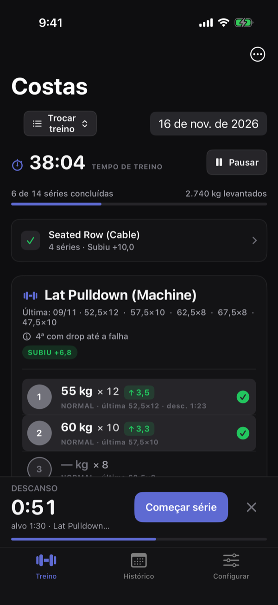

# Gimmy

> **App pessoal.** O Gimmy é o app que uso para controlar os meus treinos, e só isso. Ele existe para o meu uso, lendo e gravando na minha própria planilha. Não é distribuído, não tem instruções de instalação, não aceita contribuições nem pedidos de funcionalidade, e pode mudar a qualquer momento.

App de iPhone (SwiftUI) para registrar os meus treinos. A base de dados é a minha planilha de treinos no Google Sheets: o app lê e grava direto nela.

## O que tem no app

- **Treino**: escolhe o treino (o seletor só mostra os vigentes na data) e a data. Num dia sem treino, Começar treino cria uma cópia do treino configurado, com exercícios, tipos de série e reps, e só as cargas em branco. Registra cada série (carga, reps, tipo, unidade, descanso), adiciona série e exercício, e finaliza com a duração.
- **Descanso**: depois de registrar uma série, o relógio de descanso aparece em baixo. Quando chega no alvo do exercício (padrão 1:30), o iPhone avisa com notificação e som, mesmo bloqueado.
- **Histórico**: treinos por mês, com volume e variação contra o treino anterior, exercícios que subiram ou caíram e recordes. Dá para abrir um treino antigo para editar.
- **Configurar**: cria e edita os treinos. Cada treino tem nome e vigência (início e fim; o atual fica sem fim), uma lista de exercícios em ordem e, em cada exercício, as séries (tipo e reps), o descanso alvo, a unidade e as notas. Um nome pode voltar com outra vigência (um plano novo de Costas, por exemplo) sem misturar com o antigo.

Regras de cálculo: numeração de séries com drop e rest-pause (3.1, 3.2), descanso curto dentro da sequência (10 s depois de drop, 15 s depois de rest-pause), 1RM estimado (Brzycki até 10 reps, Epley acima), volume em kg sem aquecimento (em exercícios medidos em placas, cada placa vale 4,5 kg), recorde só quando o exercício também subiu.

## Telas

<table>
  <tr>
    <td align="center" width="33%"><br><sub>Treino do dia</sub></td>
    <td align="center" width="33%"><br><sub>Registrar uma série</sub></td>
    <td align="center" width="33%"><br><sub>Histórico</sub></td>
  </tr>
  <tr>
    <td align="center"><br><sub>Treinos e vigência</sub></td>
    <td align="center"><br><sub>Configurar um treino</sub></td>
    <td align="center"><br><sub>Séries de um exercício</sub></td>
  </tr>
</table>

Os prints usam dados de exemplo, não a planilha de verdade.

## Como a planilha é usada

| Aba | O app lê | O app grava |
|---|---|---|
| Registro | A–Q | A–F ao montar treino ou adicionar séries/exercícios (insere linhas), D–F ao salvar série, P (descanso), Q (duração) |
| Rotinas | A–L | pela aba Configurar: A–C, F–L (D e E têm fórmulas e nunca são gravadas); insere e apaga linhas |
| Exercícios | A–D | D (unidade: kg, lb ou placas), ou uma linha nova para exercício novo |

Na aba Rotinas, cada linha é um exercício de um treino:

- **G (Reps)** tem uma rep por série, na ordem: `12-10-8-6-8`.
- **J (Tipos)** tem o tipo de cada série, na mesma ordem: `Aquecimento, Normal, Normal, Drop, Normal`. Linhas sem J (as antigas) continuam valendo: o app copia as séries do último treino daquele exercício, ou usa F e G.
- **K (Início)** e **L (Fim)** são a vigência do treino, repetidas em todas as linhas dele. L vazio é o treino atual; K e L vazios valem sempre. Linhas com o mesmo nome e o mesmo início formam um treino.
- Um treino sem exercícios fica guardado numa linha só com nome e datas.

Antes de gravar numa linha, o app confere se ela ainda tem o que ele espera. Se a planilha mudou (por exemplo, editada no computador), ele recarrega e pede para conferir.

## Estrutura

```
Gimmy/
  App/        entrada do app e configuração
  Google/     login OAuth (PKCE, Keychain) e cliente da API do Sheets
  Model/      regras de treino (Ledger), treinos configurados e vigência (Plan), estado e ações (AppModel), aviso de descanso
  Views/      telas SwiftUI
  Resources/  Info.plist, ícone e cor de destaque
GimmyTests/   testes unitários das regras de treino (rodam no CI)
GimmyUITests/ teste de interface que tira os prints deste README
docs/         prints deste README
project.yml   projeto do XcodeGen (o .xcodeproj é gerado, não versionado)
```

## Interface

O visual segue o design system **Kinetic Dark Minimal**, descrito em [`DESIGN.md`](DESIGN.md) e implementado em `Gimmy/App/Theme.swift`: modo escuro, superfícies em camadas, índigo `#5E6AD2` como cor de ação e uma cor por tipo de série. A tela de treino mostra um exercício por vez, e tocar numa série abre o painel com a Entrada Rápida de carga e reps.
